# TestFlow – Full Application Guide with Screenshots
### Software Test Management System with ISTQB & IEEE 829 Methodologies
**Authors & Lead QA:** Eya Khandoudi & Ichraf Sassi (ISTQB Certified Testers)

Welcome to the comprehensive application guide for **TestFlow**. This guide walks through every module of the application with live screenshots, detailed UI breakdowns, and direct mappings to **ISTQB Foundation & Advanced Level software testing techniques**.

---

## Table of Contents
1. [QA Testing Dashboard & Release Gate](#1-qa-testing-dashboard--release-gate)
2. [Requirements Management & Test Basis](#2-requirements-management--test-basis)
3. [Test Case Repository & Risk-Based Testing](#3-test-case-repository--risk-based-testing)
4. [Test Case Design & Specification](#4-test-case-design--specification)
5. [Test Runs & Execution Cycles](#5-test-runs--execution-cycles)
6. [Test Execution & Recording Modal](#6-test-execution--recording-modal)
7. [Defect Management & ISTQB Lifecycle](#7-defect-management--istqb-lifecycle)
8. [Defect Detail & State Transition Engine](#8-defect-detail--state-transition-engine)
9. [Defect Reporting & Decision Table Triage](#9-defect-reporting--decision-table-triage)
10. [Requirements Traceability Matrix (RTM)](#10-requirements-traceability-matrix-rtm)
11. [IEEE 829 Test Summary Report](#11-ieee-829-test-summary-report)
12. [Interactive ISTQB Methodology Guide](#12-interactive-istqb-methodology-guide)

---

## 1. QA Testing Dashboard & Release Gate
**URL:** `http://127.0.0.1:5000/`

The dashboard serves as the central command center for the QA team, visualizing test execution progress, defect severity distributions, and the automated **IEEE 829 Release Gate Decision**.

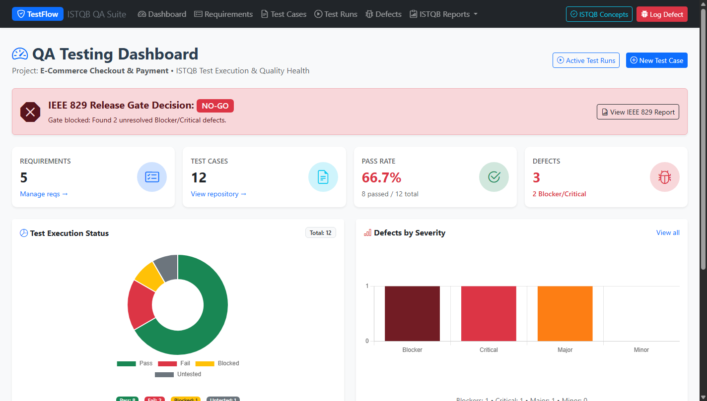

### Key Components:
- **Decision Table Release Gate:** Automatically assesses exit criteria:
  - If open blocker/critical defects $> 0 \rightarrow$ **NO-GO** (Red alert banner).
  - If pass rate $\ge 90\%$ and critical tests pass $\rightarrow$ **GO** (Green banner).
  - If pass rate $\ge 75\%$ without blockers $\rightarrow$ **CONDITIONAL GO** (Yellow banner).
- **KPI Metrics Cards:** Requirements count, total test cases, real-time pass rate percentage, and open blocker/critical defects count.
- **Interactive Chart.js Visualizations:**
  - *Execution Status Doughnut Chart:* Real-time breakdown of Pass, Fail, Blocked, and Untested scenarios.
  - *Defects by Severity Bar Chart:* Live count of Blocker, Critical, Major, and Minor defects.
- **Active Test Cycles & Recent Incidents:** Instant jump shortcuts to ongoing test executions and open bugs.

---

## 2. Requirements Management & Test Basis
**URL:** `http://127.0.0.1:5000/requirements/`

In the **ISTQB Test Analysis phase**, requirements establish the formal *Test Basis*. Every functional requirement is mapped to its acceptance criteria and monitored for coverage gaps.

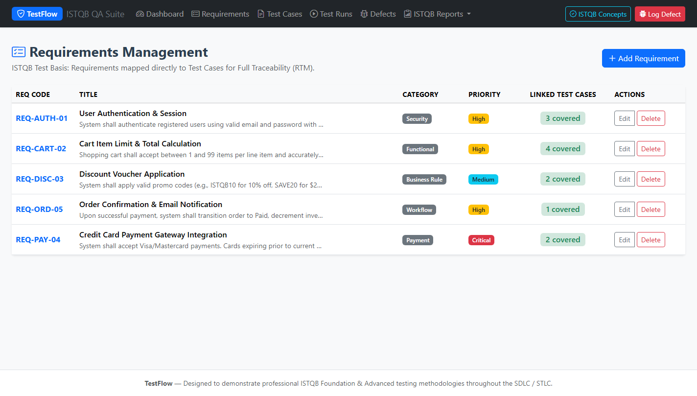

### Key Components:
- **Requirement Identifiers:** Structured IDs (`REQ-AUTH-01`, `REQ-CART-02`, `REQ-PAY-04`, etc.).
- **Category & Priority Classification:** Functional, Security, Business Rules, Payment, and Workflow.
- **Coverage Gap Detection:** Displays the exact number of linked test cases. If a requirement has zero test cases, a red **0 (Coverage Gap)** warning badge is displayed to alert the QA lead.

---

## 3. Test Case Repository & Risk-Based Testing
**URL:** `http://127.0.0.1:5000/test-cases/`

The test case repository houses test specifications designed with formal specification-based techniques. It features a **Risk-Based Testing (RBT)** priority sort.

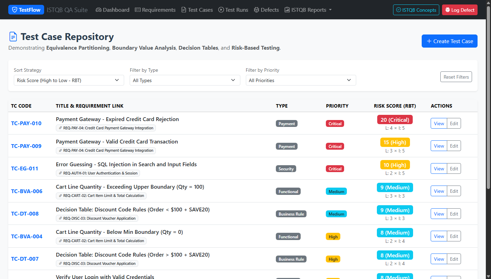

### Key Components:
- **Risk Score (RPN) Column:** Displays the calculated product risk ($Likelihood \times Impact = 1 \dots 25$) with color-coded categories:
  - **Critical (16 - 25):** Red badge (e.g., `TC-PAY-010` Score 20)
  - **High (10 - 15):** Orange/Warning badge (e.g., `TC-PAY-009` Score 15)
  - **Medium (5 - 9):** Cyan/Info badge
  - **Low (1 - 4):** Green/Success badge
- **Sorting Strategy:** Allows sorting by Risk Score (descending), Priority (Critical to Low), or Test Case Code.
- **Requirement Linkage:** Directly shows which requirement each test case covers.

---

## 4. Test Case Design & Specification
**URLs:**
- **Create:** `http://127.0.0.1:5000/test-cases/new`
- **Detail:** `http://127.0.0.1:5000/test-cases/4`

### Test Case Creation Form
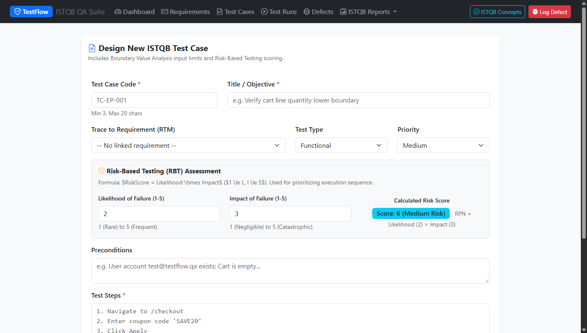

Features real-time interactive **Risk Priority Number calculation**: as the tester slides Likelihood and Impact from 1 to 5, the UI dynamically computes the score and risk category badge. **Boundary Value Analysis (BVA)** and **Equivalence Partitioning (EP)** limits are strictly enforced on all text and numeric inputs.

### Test Case Detailed View
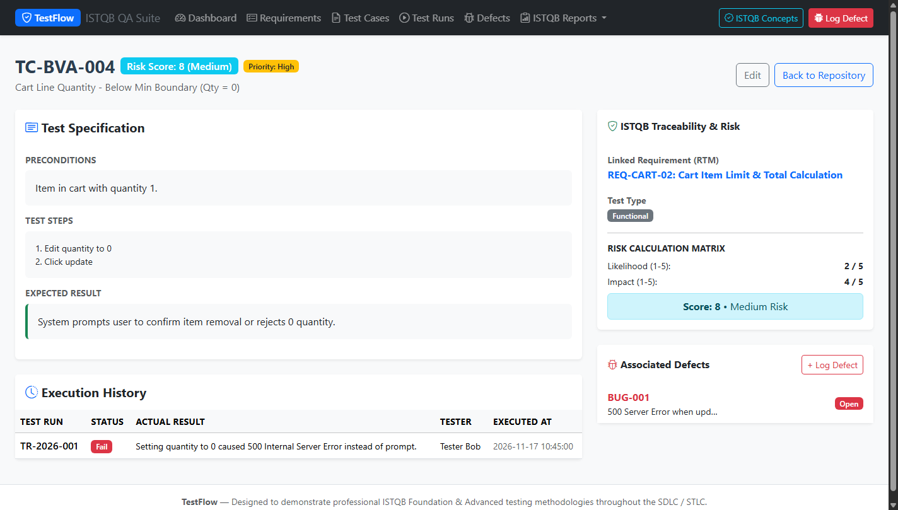

Shows the complete specification: preconditions, step-by-step test procedure, expected results, execution history log across all test runs, and associated defects raised from this test case.

---

## 5. Test Runs & Execution Cycles
**URL:** `http://127.0.0.1:5000/test-runs/`

In the **ISTQB Test Execution phase**, test suites are snapshot into test runs configured for specific environments (QA, Staging, UAT, Production).

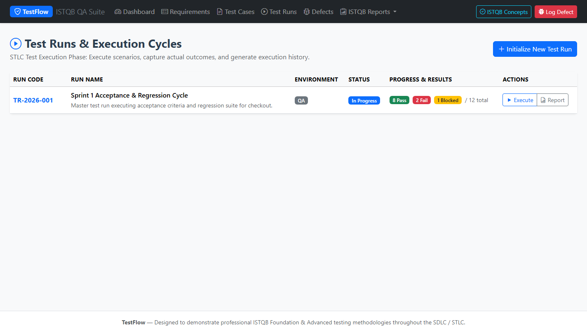

### Key Components:
- **Run Tracking:** Unique run codes (e.g. `TR-2026-001`), cycle names, and environments.
- **Live Progress Counter:** Shows total tests, count of Passed, Failed, and Blocked tests.
- **Actions:** Direct links to execute tests or generate the official IEEE 829 summary report for that cycle.

---

## 6. Test Execution & Recording Modal
**URL:** `http://127.0.0.1:5000/test-runs/1`

The test execution dashboard displays all assigned test cases for a run, automatically prioritized with the highest-risk tests appearing at the top.

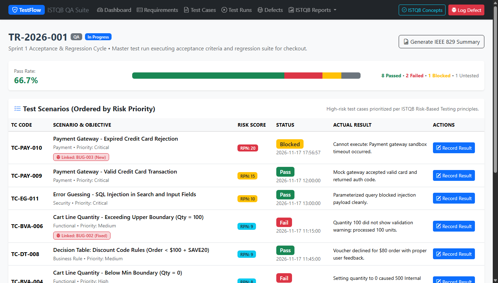

### Key Features:
- **One-Click Execution Recording:** Testers open the modal to record outcomes (`Pass`, `Fail`, `Blocked`, `Skipped`), enter actual observations, and log timestamps.
- **Direct Defect Creation:** When a test fails, a red **"Log Bug"** button appears next to the failed test, pre-populating the test case and run details.
- **Linked Incidents:** Shows badges for any defects already raised and linked to the test execution.

---

## 7. Defect Management & ISTQB Lifecycle
**URL:** `http://127.0.0.1:5000/defects/`

TestFlow implements the formal **ISTQB Defect Lifecycle** with strict state machine transition validation.

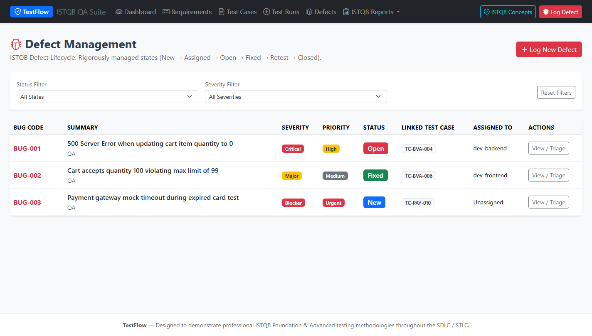

### Filter Options:
- **Status Filter:** `New`, `Assigned`, `Open`, `Fixed`, `Retest`, `Closed`, `Reopened`, `Deferred`, `Rejected`.
- **Severity Filter:** `Blocker`, `Critical`, `Major`, `Minor`.

---

## 8. Defect Detail & State Transition Engine
**URL:** `http://127.0.0.1:5000/defects/1`

This view provides hands-on interaction with the **State Transition Testing (STT)** engine.

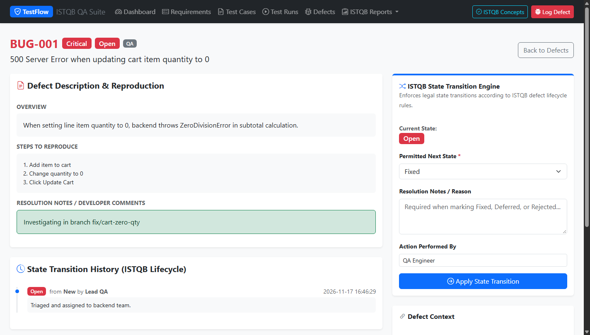

### State Machine Enforcement:
- **Permitted Next State Dropdown:** The dropdown *only* displays legally permitted next states for the defect's current status:
  - From `New`: `Assigned`, `Rejected`, `Deferred`
  - From `Assigned`: `Open`, `Deferred`, `Rejected`
  - From `Open`: `Fixed`, `Deferred`, `Rejected`
  - From `Fixed`: `Retest`
  - From `Retest`: `Closed` (if pass) or `Reopened` (if fail)
- **Illegal Jumps Blocked:** Direct illegal jumps (e.g. attempting `New` $\rightarrow$ `Closed`) are blocked with an `InvalidStateTransitionError`.
- **Resolution Justification:** Moving to `Fixed`, `Rejected`, or `Deferred` requires mandatory resolution comments.
- **Audit Timeline:** Complete chronological history showing previous status, new status, changed by, and developer/tester notes.

---

## 9. Defect Reporting & Decision Table Triage
**URL:** `http://127.0.0.1:5000/defects/new`

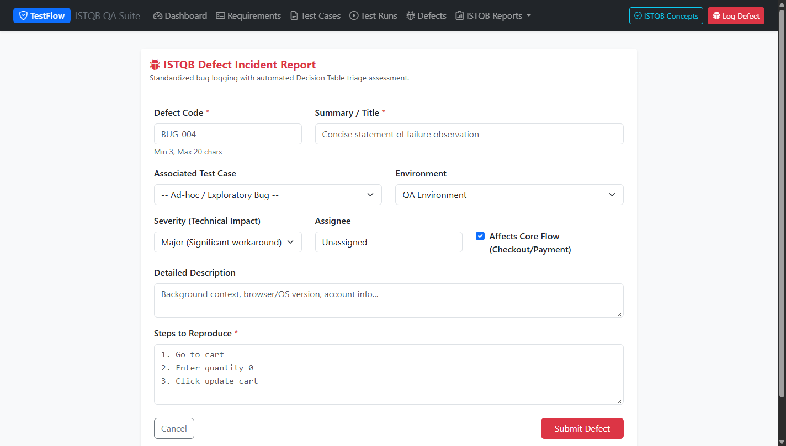

### Automated Decision Table Triage:
When submitting a bug, TestFlow evaluates an internal **ISTQB Decision Table**:
- **Severity** + **Environment** + **Core Flow Flag** $\rightarrow$ Automatically determines recommended Priority SLA (Urgent: 4h SLA, High: 24h SLA, etc.) and whether escalation is required.

---

## 10. Requirements Traceability Matrix (RTM)
**URL:** `http://127.0.0.1:5000/rtm`

The Requirements Traceability Matrix establishes end-to-end forward and backward traceability across the entire lifecycle:
$$\text{Requirement (Test Basis)} \longleftrightarrow \text{Test Case (Design)} \longleftrightarrow \text{Test Execution (STLC)} \longleftrightarrow \text{Defect (Incident)}$$

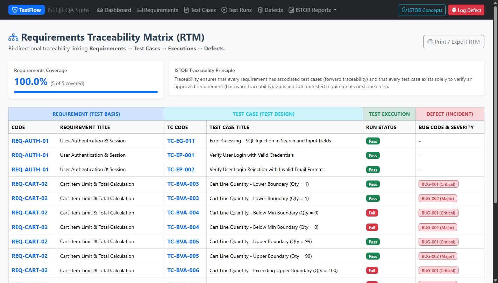

### Key Features:
- **Coverage Gauge:** Visual percentage meter showing the exact ratio of requirements covered by test cases (100% in sample project).
- **Orphan Detection:** Flags any test cases that lack an underlying requirement.
- **Bi-directional Verification:** Proves that every requirement has tests, and every defect is traced back to a specific requirement and test case.
- **Print / PDF Export:** Dedicated print-formatted view for stakeholder reviews.

---

## 11. IEEE 829 Test Summary Report
**URL:** `http://127.0.0.1:5000/report/1`

Generates an official Test Completion Report conforming to the international **IEEE Std 829-2008 Standard**.

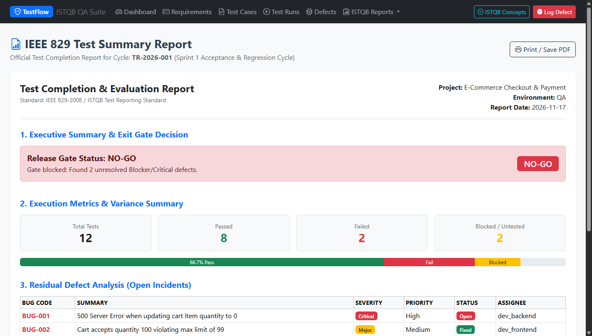

### Report Structure:
1. **Header & Context:** Test Plan Identifier, Project Name, Target Environment, and Run Code.
2. **Executive Summary & Exit Gate Decision:** Formal release gate verdict with pass/fail metrics.
3. **Execution Metrics & Variances:** Total tests, pass rate, failed count, and blocked reasons.
4. **Residual Defect Analysis:** Table of remaining open defects categorized by severity.
5. **Sign-Off & Approvals:** Formal sign-off section for Lead QA Engineer, Development Lead, and Product Owner.

---

## 12. Interactive ISTQB Methodology Guide
**URL:** `http://127.0.0.1:5000/istqb-guide`

Built directly into the application, this interactive reference explains each testing technique, how it is implemented within TestFlow, and links to the automated verification tests.

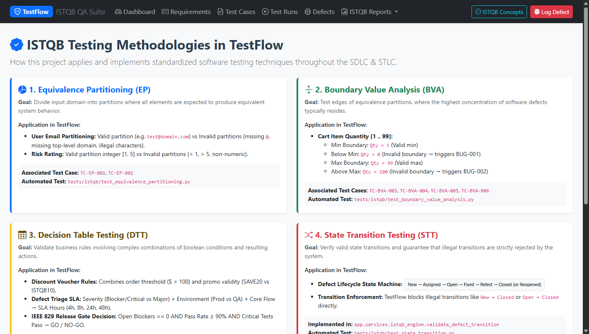

### Covered Methodologies:
- **Equivalence Partitioning (EP)**
- **Boundary Value Analysis (BVA)**
- **Decision Table Testing (DTT)**
- **State Transition Testing (STT)**
- **Risk-Based Testing (RBT)**
- **Error Guessing & Regression Testing**

---

## Summary of Verification Commands

All 92 automated tests can be verified at any time using the following commands:

```bash
# Run complete test suite (92 tests)
pytest

# Run tests with code coverage analysis (91% coverage)
pytest --cov=app --cov-report=term-missing

# Run by specific ISTQB technique marker
pytest -m equivalence_partitioning
pytest -m boundary_value_analysis
pytest -m decision_table
pytest -m state_transition
pytest -m error_guessing
pytest -m risk_based
pytest -m regression
pytest -m api
```
